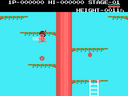

# go-msx-treegame

A native Go port of a 16KB MSX1 cartridge game (a 1984 tree-climbing
platformer). This is **not an emulator**: no Z80 code runs at runtime. Each
original routine is read, understood and rewritten as ordinary Go against a
small hardware-abstraction layer.



**Status: complete.** The whole engine is ported and playable, with sound.
It matches the original byte for byte, tick by tick, over the attract
sequence, the demo and scripted games (see "Verification"). Game over and
stage clear have been confirmed by play-testing.

## Requirements

- Go 1.27+
- Your own copy of the original ROM, placed in the repository root as:

  `Magical Tree - Konami (1984) [RC-713] [1393].rom`

  (16384 bytes, SHA-1 `f4b58fecbcbc8cd307c34806ecece2a204c26c65`)

## Playing

```bash
go run ./cmd/extract     # once: derive the assets from your ROM
go run ./cmd/play        # arrows move, SPACE jumps/starts, Left Shift = SELECT, Esc quits
```

Cheat: on the PLAY SELECT screen, press 1-9 to start at that stage in the
selected mode; the chosen stage is shown briefly as an overlay. This is an
extension; the original has no level select.

## Tools

| Command | Purpose |
| --- | --- |
| `go run ./cmd/extract [-check]` | Derive `assets/*.bin` from the ROM (or verify them) |
| `go run ./cmd/play [-record keys.txt]` | Play in a window; optionally record input |
| `go run ./cmd/screenshot` | Headless stills (the regression baseline in `screenshots/`) |
| `go run ./cmd/refcompare -trace t [-keys k]` | Lockstep comparison against a trace of the original |
| `go run ./cmd/disasm [-gaps] [-peek A-B]` | Disassembly to `docs/listing.asm` (gitignored) |
| `go run ./cmd/rledecode ADDR...` | Decode RLE streams |
| `go run ./cmd/gfxpreview`, `cmd/vramview` | Tile/sprite sheets; render VRAM dumps |
| `go run ./cmd/sndpreview -id 0x8C` | Render a sound to WAV |

## Verification

`scripts/refdump.tcl` records the original's RAM, VRAM and VDP registers
at the start of every game tick in openMSX (with the free C-BIOS), and
`cmd/refcompare` runs the port in lockstep against it. The emulator is
only an offline reference; the port itself executes no Z80 code.

## Legal

This is an unofficial, non-commercial fan project. It is not affiliated with
or endorsed by the original rights holder. The repository contains only
original source code; it does not include or distribute the ROM, any data
extracted from it, or a disassembly. The engine executes no original code.
Rights holders with concerns are invited to get in touch. See [NOTICE](NOTICE).
